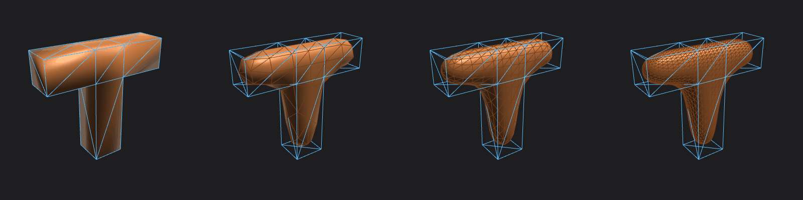
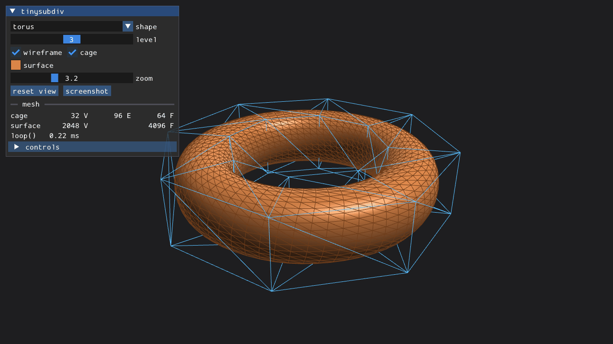
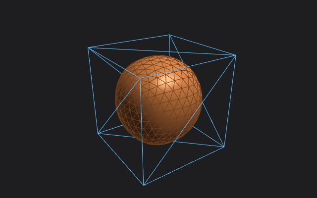
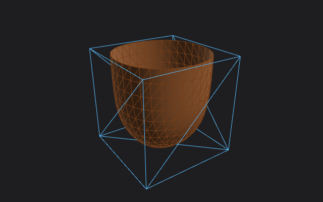
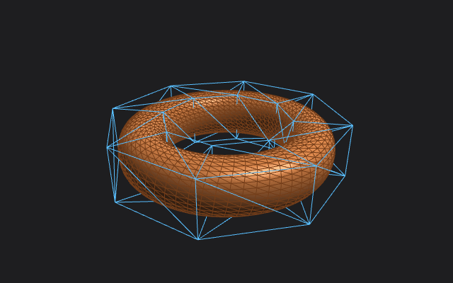
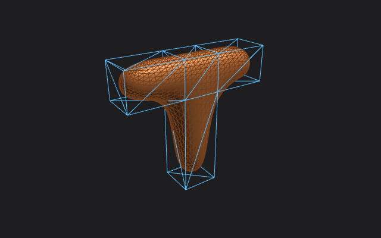

# tinysubdiv

[](https://github.com/varnholt/tinysubdiv/actions/workflows/ci.yml)

Loop subdivision for triangle meshes in a single C++23 header, plus an
OpenGL ES 3 testbed that also runs in the browser (WebGL2 via Emscripten).

**[Live demo](https://varnholt.github.io/tinysubdiv/)**: the testbed as WebAssembly, right in your browser.



- one header, no dependencies: copy `include/tinysubdiv/tinysubdiv.hpp` into your project
- or use it as a CMake library: `add_subdirectory`, `FetchContent` or `find_package`
- open boundaries and non-manifold edges are handled as creases, so open meshes keep a clean rim
- `weld()` merges duplicated vertices from OBJ exports, so UV and normal seams do not tear

## Usage

```cpp
#include <tinysubdiv/tinysubdiv.hpp>

tinysubdiv::Mesh cage;
cage.positions = {{0, 0, 0}, {1, 0, 0}, {0, 1, 0}, {0, 0, 1}};
cage.triangles = {{0, 2, 1}, {0, 1, 3}, {0, 3, 2}, {1, 2, 3}};

const tinysubdiv::Mesh smooth = tinysubdiv::loop(cage, 3);
const auto normals = tinysubdiv::vertex_normals(smooth);
```

`Vec3` is three tightly packed floats and `Triangle` three `uint32_t` indices, so
both vectors can go straight into vertex and index buffers.

| | |
|---|---|
| `Mesh loop(const Mesh&, int levels = 1)` | Loop subdivision; each level turns V vertices, E edges, F triangles into V + E vertices and 4F triangles |
| `Mesh weld(const Mesh&, float epsilon = 0)` | merges vertices closer than `epsilon` (exact matches for 0), drops collapsed triangles and unused vertices |
| `std::vector<Vec3> vertex_normals(const Mesh&)` | area-weighted unit normals |
| `std::vector<std::array<uint32_t, 2>> edges(const Mesh&)` | unique edges, e.g. for a wireframe |
| `void validate(const Mesh&)` | throws `std::invalid_argument` for out-of-range indices or degenerate triangles |

`loop`, `weld`, `vertex_normals` and `edges` validate their input the same way.

### Rules

- an edge shared by exactly two triangles is smooth; any other edge (open boundary or non-manifold) is sharp
- new point on a smooth edge: 3/8 (a + b) + 1/8 (c + d); on a sharp edge: the midpoint
- vertex without sharp edges: Loop's weights over its n neighbours
- vertex with two sharp edges: 3/4 v + 1/8 (s1 + s2), so boundaries stay smooth curves
- vertex with one or more than two sharp edges: a corner, it keeps its position

Subdivision works on positions. Texture coordinates and other per-corner data are
not carried over yet.

## Testbed

[](https://varnholt.github.io/tinysubdiv/)

 
 

The testbed shows the control cage (blue) over the subdivided surface. It uses only
OpenGL ES 3.0, which is what WebGL2 provides, so the same code runs natively
(GLFW + glad) and in the browser (Emscripten).

```sh
cmake -S . -B build -DTINYSUBDIV_BUILD_TESTBED=ON
cmake --build build
./build/testbed/tinysubdiv_testbed                 # built-in shapes
./build/testbed/tinysubdiv_testbed model.obj       # your own mesh first
```

A Dear ImGui panel picks the shape and level, toggles wireframe and cage, sets the
surface colour, saves screenshots and shows vertex/edge/face counts and how long
`loop()` took. Shortcuts: drag to orbit, scroll to zoom, Up/Down level, Space or
Left/Right shape, W wireframe, C cage, R reset view.

Screenshots without opening a window:

```sh
./build/testbed/tinysubdiv_testbed --shape torus --level 3 --size 1280x720 --screenshot torus.png
```

In the browser (this is what the [live demo](https://varnholt.github.io/tinysubdiv/) runs, built and
deployed by CI on every push to the default branch):

```sh
emcmake cmake -S . -B build-web -DTINYSUBDIV_BUILD_TESTBED=ON
cmake --build build-web
python -m http.server -d build-web/testbed   # open http://localhost:8000/tinysubdiv_testbed.html
```

On Linux the native build needs the GLFW dependencies, e.g.
`sudo apt install xorg-dev libwayland-dev libxkbcommon-dev wayland-protocols libgles-dev`.

## Integration

Needs C++23 (GCC 14, Clang 19, MSVC 19.38 or newer; CI covers all three and Emscripten).

### Single header

Copy `include/tinysubdiv/tinysubdiv.hpp`, then `#include "tinysubdiv.hpp"`.

### CMake FetchContent

```cmake
include(FetchContent)
FetchContent_Declare(tinysubdiv GIT_REPOSITORY https://github.com/varnholt/tinysubdiv.git GIT_TAG master)
FetchContent_MakeAvailable(tinysubdiv)

target_link_libraries(my_app PRIVATE tinysubdiv::tinysubdiv)
```

### Installed package

```sh
cmake -S . -B build
cmake --install build --prefix /some/prefix
```

```cmake
find_package(tinysubdiv 1 REQUIRED)
target_link_libraries(my_app PRIVATE tinysubdiv::tinysubdiv)
```

Tests and the OBJ example build only when tinysubdiv is the top-level project; the
testbed only with `TINYSUBDIV_BUILD_TESTBED=ON`. Override with `TINYSUBDIV_BUILD_TESTS`,
`TINYSUBDIV_BUILD_EXAMPLES` and `TINYSUBDIV_INSTALL`.

## Command line example

```sh
./build/examples/tinysubdiv_obj input.obj output.obj 2        # weld, then 2 levels
./build/examples/tinysubdiv_obj input.obj output.obj 2 1e-4   # weld within 1e-4
```

## Rust

**[Interactive Rust demo](https://varnholt.github.io/tinysubdiv/rust/)** — [native and browser build instructions](rust/demo/README.md).

[`rust/`](rust/README.md) contains the native `tinysubdiv` Rust crate: no dependencies and no C++ toolchain required. It includes examples, tests against the C++ implementation, and Cargo packaging. See the [Rust README](rust/README.md) for the API and local installation.

## License

[MIT](LICENSE). The testbed uses [GLFW](https://www.glfw.org) (zlib),
[Dear ImGui](https://github.com/ocornut/imgui) (MIT), a [glad](https://github.com/Dav1dde/glad)
generated loader and [stb_image_write](https://github.com/nothings/stb) (public domain / MIT).
The library header itself has no dependencies.
