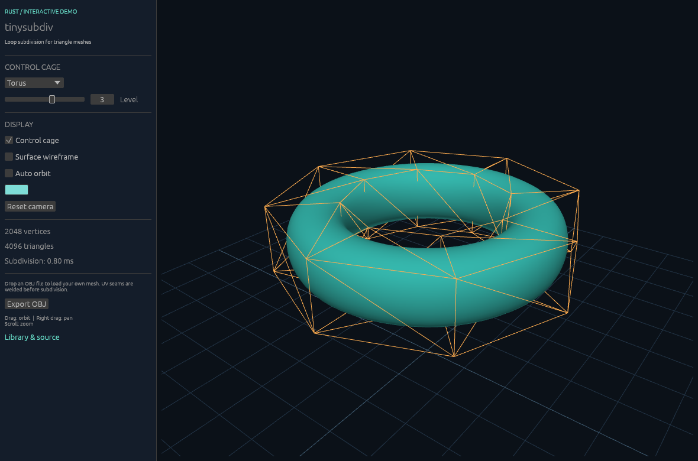

# tinysubdiv interactive Rust demo

[Open the browser demo](https://varnholt.github.io/tinysubdiv/rust/)



- Five C++ control cages: cube, open box, tetrahedron, torus and letter T.
- Subdivision levels 0–5, smooth lighting, cage and surface wireframes, color control, orbit/pan/zoom.
- Drag-and-drop OBJ loading on native and web, seam welding, and OBJ export. Imported geometry is centered and fitted to the view. Polygon faces are triangulated as fans, so import convex polygons or pre-triangulate concave faces.
- Input size and subdivision growth limits keep accidental large meshes bounded.

## Run natively

The demo uses Rust **1.95** and eframe 0.36.2. The library still supports Rust 1.85 and has no rendering dependencies. This is a separate, unpublished Cargo package; it does not add dependencies to the published crate.

From the repository root:

```sh
rustup toolchain install 1.95
cargo +1.95 run --release --manifest-path rust/demo/Cargo.toml
```

Linux also needs windowing libraries, for example `libxkbcommon-dev`, `libwayland-dev`, `libx11-dev`, `libgl1-mesa-dev` and `libegl1-mesa-dev` on Ubuntu. Rendering uses OpenGL on native platforms and WebGL 2 in browsers.

## Build for the browser

```sh
rustup target add wasm32-unknown-unknown --toolchain 1.95
cargo +1.95 install wasm-bindgen-cli --version 0.2.130 --locked
python rust/demo/tools/build_web.py
python -m http.server 8080 --directory rust/demo/dist
```

Open `http://localhost:8080/`. The generated `dist/` directory is a standalone static site. The binding generator version is pinned to match the Wasm dependency. Graphics initialization failures are shown on the loading screen.

## Verify

```sh
cargo +1.95 fmt --manifest-path rust/demo/Cargo.toml --check
cargo +1.95 clippy --manifest-path rust/demo/Cargo.toml --locked --all-targets -- -D warnings
cargo +1.95 test --manifest-path rust/demo/Cargo.toml --locked
```

CI builds and tests native demos on Linux, Windows and macOS, builds the browser application, and exercises rendered scenes and pointer input in headless Chromium. Browser screenshots are uploaded as CI artifacts. Core library tests remain independent of the demo.

For browser smoke checks, build `dist/`, run `npm install --no-save --package-lock=false playwright@1.65.0` and `npx playwright install chromium` from `rust/demo/`, then run `node tools/smoke_web.mjs`. The script starts a local server; `WEB_DEMO_URL` can point it at an already running copy. `CHROMIUM_PATH` can select an installed Chromium executable.

Camera controls: drag to orbit, right-drag to pan, scroll to zoom.

Native flags: `--shape "Letter T" --level 3` or `--obj mesh.obj`. Native OBJ export writes `subdivided.obj` in the working directory; browser export downloads it. Query-string options use the same names, for example `?shape=Torus&level=3`.

For reproducible native captures, build with `--features screenshot` and set `EFRAME_SCREENSHOT_TO=out.png`; the application saves a frame and exits.
